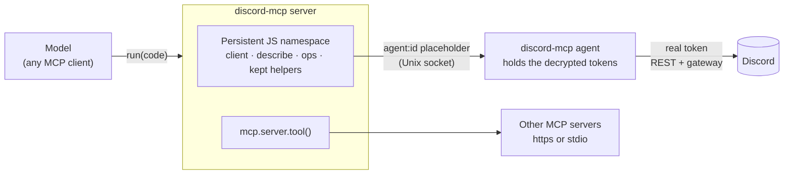

<div align="center">


### Discord for language models, through one tool that runs code

The model discovers the live discord.js API, writes its own helpers,<br>
and keeps them across calls and restarts, instead of picking from a fixed menu of verbs.

[](#quick-start)
[](#the-run-tool)
[](https://discord.js.org)
[](#development)
[](LICENSE)

[Quick start](#quick-start) ·
[The run tool](#the-run-tool) ·
[Secrets](#secrets-the-ssh-model) ·
[Other MCP servers](#other-mcp-servers-as-functions) ·
[Configuration](#configuration) ·
[Security](#security)


<sub>The 25-second teaser plays above, silent. With sound: <a href="assets/video/trailer.mp4">trailer.mp4</a> (6.6 MB download).</sub>

</div>

> [!WARNING]
> **The one tool this server exposes runs JavaScript with the server's full authority**: the network, the filesystem, the process. That is the design, not a mode, and there is no switch to turn it off. **Run the server sandboxed** (a container, VM or jail with only the access you intend to grant), and keep Discord tokens out of it with [`discord-mcp agent`](#secrets-the-ssh-model): then the code can *use* Discord but can never *read* a token.

## Why one code tool

A fixed catalog of typed tools is the wrong interface for Discord. Every bot, permission set and library version supports a different slice of the API, and different models are good with different tools. So this server doesn't hand-pick verbs. It exposes a single tool, `run`, gives the code a live discord.js client, and lets each deployment's model build the tooling it needs.

```js
// call 1: the model writes a helper...
async function channelByName(guildId, name) {
  const guild = await client.guilds.fetch(guildId);
  return (await guild.channels.fetch()).find((c) => c.name === name);
}

// call 2 (or next week, after a restart): ...and reuses it
const general = await channelByName("123456789012345678", "general");
await general.send(vars.announcement);
```

**Highlights**

- **One tool, the whole API.** `client` is a real discord.js `Client`. `describe(x)` shows live state and every method's signature and doc, so the model can find its way.
- **It remembers.** Functions, classes and constants the model defines are saved and reloaded on restart. Side effects never are.
- **Tokens stay out of reach.** An ssh-agent-style agent holds the tokens, so the server and the model only ever see `agent:<id>`.
- **Other MCP servers become functions.** `mcp.github.get_issue(...)` inside the same code, not a growing list of tools.
- **Hardened networking.** Optional proxy for all Discord traffic, https-only upstreams with `known_hosts` pinning, per-identity latency, and tokens kept out of logs and traces.

## How it works



## Quick start

**Prerequisites:** Node.js 22.15+, npm, and a [Discord bot token](https://discord.com/developers/applications).

```bash
git clone https://github.com/drvova/discord-mcp.git
cd discord-mcp
npm install            # also builds dist/
```

**1. Store the token, encrypted, like an SSH key.** You're prompted (hidden) for the token and a passphrase.

```bash
node dist/bootstrap.js identity add default-bot
```

**2. Start the agent** in its own terminal, like `ssh-agent`. It asks for the passphrase and prints the socket to use.

```bash
node dist/bootstrap.js agent
# DISCORD_MCP_AGENT_SOCK=/run/user/1000/discord-mcp/agent.sock; export DISCORD_MCP_AGENT_SOCK;
```

**3. Point your MCP client at the server**, with only the agent socket in its environment:

```json
{
  "mcpServers": {
    "discord": {
      "command": "node",
      "args": ["/absolute/path/to/discord-mcp/dist/bootstrap.js"],
      "env": { "DISCORD_MCP_AGENT_SOCK": "/run/user/1000/discord-mcp/agent.sock" }
    }
  }
}
```

Then ask the model to call `run` with empty code: it gets the manual and takes it from there.

<details>
<summary><b>Quicker, less safe: direct mode</b></summary>

<br>

Skip the agent and give the server the token directly:

```bash
DISCORD_TOKEN=your_bot_token node dist/bootstrap.js
```

This works, but the token then lives in the server process, where code in the `run` tool can read it (for example through the client's auth config). The server warns about this at startup. Secret environment variables are removed from `process.env` once read, in both modes.

</details>

<details>
<summary><b>Other ways to run it</b></summary>

<br>

| Command | What it does |
| --- | --- |
| `npm start` | stdio server (the default MCP transport) |
| `npm run web` | HTTP + SSE server on port 1455 (see [HTTP mode](#http-mode)) |
| `npm run dev` | rebuild on change and restart, with pretty logs |
| `docker compose up` | containerised server; mount a volume at `/data` to keep the model's helpers |

</details>

## The run tool

`run` is the only tool the server advertises.

| Argument | Type | |
| --- | --- | --- |
| `code` | string, required | JavaScript to run. **Empty returns the manual.** |
| `identity` | string | Identity to bind as `client` before the code runs, e.g. `default-bot` |
| `vars` | object of strings | Named strings available as `vars.<name>`, for long text or payloads you'd rather not escape inside `code` |

The code runs in **one long-lived namespace** with top-level `await`. The result is whatever it printed plus the value of its last expression.

### What's in the namespace

| Name | What it is |
| --- | --- |
| `client` | The bound discord.js `Client`; drive its full API directly |
| `identities()`, `bind(id)`, `connect(id, { mode, token })` | List and switch identities; `connect` only in direct mode |
| `identity` | `{ id, mode }` of the bound identity |
| `describe(x)` | Live capabilities (for a client: ready, user, intents, guilds, REST latency) and every member's signature with a one-line doc from discord.js's JSDoc |
| `packages()`, `symbols(query)`, `pkg(alias)`, `discord` | The loaded Discord packages, their symbols and exports, and the discord.js module |
| `ops.packages / symbols / preflight / refresh / invoke / batch` | Structured operations with dry runs and preflight checks, as plain functions |
| `mcp.<server>.<tool>(args)`, `mcpServers()`, `mcpConnect()`, `mcpDisconnect()` | [Other MCP servers](#other-mcp-servers-as-functions) as functions |
| `network()` | Proxy and TLS policy, latency per identity and server, gateway ping |
| `kept()`, `kept(name)`, `forget(name)` | Saved definitions |
| `vars`, `print`, `console`, `fetch`, `require`, `sleep`, `man()` | I/O and utilities |

### Examples

Each block is the `code` of one `run` call.

```js
// What can this bot do right now?
describe(client)
```

```js
// Search what discord.js exports
(await symbols("TextChannel#send")).items.map((s) => s.name)
```

```js
// Check a call before making it
await ops.preflight({
  packageAlias: "discordjs",
  symbol: "TextChannel#send",
  kind: "function",
  target: "channel",
  context: { channelId: "123456789012345678" },
})
```

```js
// Switch to another identity the agent holds
await bind("ops-bot");
client.user.tag
```

### Helpers survive restarts

After each successful call, every top-level **definition** (a `function` or `class` declaration, or a `const` bound to a literal, function or class) is saved as its own file and loaded back when the server starts. Each one loads in isolation, so a broken file is reported by `kept()` and never stops the server. Statements that do work (calls, `let`, `const x = await …`) are never saved or replayed.

Definitions live in `DISCORD_MCP_KEPT_DIR` (default `~/.config/discord-mcp/kept`). In a container, mount it as a volume.

## Secrets: the SSH model

Discord tokens are handled the way SSH handles private keys.

| SSH | discord-mcp |
| --- | --- |
| `~/.ssh/id_*`, mode 600, passphrase-protected | `~/.config/discord-mcp/identities`, mode 600, AES-256-GCM under a scrypt key from your passphrase |
| `ssh-add` · `ssh-add -l` · `ssh-keygen -p` | `identity add ID` · `identity list` · `identity passwd` · `identity remove ID` |
| `ssh-agent` + `SSH_AUTH_SOCK` | `discord-mcp agent` + `DISCORD_MCP_AGENT_SOCK` |
| the agent signs; the key never leaves it | the agent puts the token on Discord requests; the server only holds `agent:<id>` |
| "UNPROTECTED PRIVATE KEY FILE!" | secret files readable by others are refused, with the `chmod` that fixes them |
| `known_hosts`, `StrictHostKeyChecking` | [`known_hosts` pinning](#network) for upstream servers and an https proxy |

<details>
<summary><b>How the agent keeps tokens out of reach</b></summary>

<br>

- **REST.** The server's discord.js client logs in as `agent:default-bot` and sends its REST requests to the agent over the Unix socket. The agent swaps the placeholder `Authorization` header for the real token and forwards the request to `https://discord.com/api`, always to that base, whatever path the client sends.
- **Gateway.** The gateway URL Discord returns is replaced with an agent address. The agent relays the WebSocket and swaps the token inside the `IDENTIFY` and `RESUME` frames. It only connects to gateway URLs Discord itself returned, which clients see as opaque handles, and only on `wss://*.discord.gg`.
- **The result.** Code in `run` can use Discord (`client`, `ops.*`, its own helpers) but can't read a token. It isn't in `client.token`, the auth config, `process.env`, the encrypted file, or the agent's API. `connect()` is disabled with the agent, so tokens never pass through the model.
- **Adding identities.** `identity add` encrypts into the file and, when `DISCORD_MCP_AGENT_SOCK` is set, also loads the identity into the running agent, like `ssh-add`; then `bind("id")`.
- **Input.** Tokens and passphrases come from a hidden prompt, a mode 600 file (`--token-file`, `DISCORD_MCP_PASSPHRASE_FILE`) or stdin, never from command-line arguments (visible in `ps`). `--token-env DISCORD_TOKEN` migrates an existing variable.
- **Unattended agents** (containers, services): set `DISCORD_MCP_PASSPHRASE_FILE` to a mode 600 file. For a Docker secret, give it `mode: 0400`.
- **Proxy.** With `DISCORD_MCP_PROXY` set, the agent sends REST *and* the gateway through it.

</details>

> [!NOTE]
> **Threat model.** Like ssh-agent, this protects tokens from code running *in the server*, not from other processes running as the same OS user with debugging rights. Start the agent separately (not as the server's child). For a hard boundary, run it as a different OS user or in its own container, sharing only the socket. Anything that can reach the socket can *use* the identities, exactly like SSH agent forwarding.

## Other MCP servers as functions

Other MCP servers aren't re-advertised as tools. Their tools become async functions in the namespace (the "code mode" pattern), so the model composes several calls in one `run`, filters results in code, and prints only what it needs:

```js
// GitHub issues mentioned in the last 50 messages of a channel
const channel = await client.channels.fetch("123456789012345678");
const refs = [...(await channel.messages.fetch({ limit: 50 })).values()]
  .flatMap((m) => [...m.content.matchAll(/#(\d+)/g)].map((x) => Number(x[1])));
for (const n of new Set(refs)) {
  const issue = await mcp.github.get_issue({ owner: "acme", repo: "app", issue_number: n });
  print(`#${n} ${issue.state} ${issue.title}`);
}
```

- **Results:** a call resolves to the tool's structured content, or its text (parsed when it's JSON). A tool error is thrown.
- **Discovery:** tool names become identifiers (`get-issue` → `get_issue`). `describe(mcp.github)` lists each tool's signature, generated from its input schema.
- **Configuration:** servers in `DISCORD_MCP_UPSTREAMS` (inline JSON or a file, in the usual `mcpServers` shape) connect at startup. `${VAR}` is read from the environment, so secrets stay out of the file:

  ```json
  {
    "mcpServers": {
      "github": { "url": "https://api.githubcopilot.com/mcp/", "headers": { "Authorization": "Bearer ${GITHUB_TOKEN}" } },
      "files": { "command": "npx", "args": ["-y", "@modelcontextprotocol/server-filesystem", "/data"] }
    }
  }
  ```

- **Transports:** `url` servers use streamable HTTP with SSE fallback (force one with `"type": "http"` or `"sse"`). `command` servers use stdio. An unreachable server shows up in `mcpServers()` and doesn't stop startup.
- **At runtime:** `mcpConnect(name, config)` adds a server until the next restart. Helpers that wrap `mcp.*` calls are saved like any other definition.

## Network

| | |
| --- | --- |
| **Proxy** | `DISCORD_MCP_PROXY` (`http://` or `https://`) carries Discord REST, upstream MCP over HTTP and `fetch` in `run`. With the agent, the Discord gateway too. Requests are tunnelled with `CONNECT`, so TLS stays end-to-end. An invalid or SOCKS URL stops startup rather than silently connecting directly. |
| **Not proxied** | In direct mode, the Discord gateway WebSocket (`@discordjs/ws` has no proxy option; it is always `wss://`). Stdio upstream servers, which are local processes. |
| **Encrypted upstreams** | Upstream MCP URLs must be `https://`, except to localhost. With `NODE_TLS_REJECT_UNAUTHORIZED=0`, https upstreams are refused. |
| **known_hosts** | Upstream servers and an https proxy are pinned by the SHA-256 of their TLS public key on first use. A changed key is refused ("REMOTE HOST IDENTIFICATION HAS CHANGED"); clear it with `discord-mcp known-hosts remove HOST:PORT`. `DISCORD_MCP_STRICT_HOST_KEY_CHECKING=yes` refuses unknown hosts. Discord isn't pinned: its certificates rotate often. |
| **Latency** | Discord REST is timed per identity and upstream calls per server (count, errors, last, avg, p50, p95), shown in `network()`, `mcpServers()` and `describe(client)`, and exported as `discord_mcp_network_latency_ms`. |
| **No tokens in telemetry** | Latency is labelled by identity or server name, never by token. Trace spans have Discord webhook and interaction tokens removed from paths (`/webhooks/123/:token`) and query strings stripped. Proxy URLs are shown without credentials. |

## Configuration

Environment variables, all optional. A `.env` file in the working directory is loaded too.

<details open>
<summary><b>Discord and identities</b></summary>

<br>

| Variable | |
| --- | --- |
| `DISCORD_MCP_AGENT_SOCK` | The agent socket. Recommended: then the server needs no token at all |
| `DISCORD_TOKEN` / `DISCORD_USER_TOKEN` | Direct mode only |
| `DISCORD_GUILD_ID` | Default guild |
| `DISCORD_INTENTS` | Comma-separated gateway intents (privileged ones must be enabled in the Developer Portal) |
| `DISCORD_MCP_CONFIG_DIR` | Where `identities` and `known_hosts` live (default `~/.config/discord-mcp`) |
| `DISCORD_MCP_IDENTITIES_FILE`, `DISCORD_MCP_KNOWN_HOSTS` | Override those two paths individually |
| `DISCORD_MCP_PASSPHRASE_FILE` | Mode 600 file with the identities passphrase, for unattended agents |
| `DISCORD_MCP_MASTER_KEY`, `DISCORD_MCP_IDENTITY_STORE_PATH` | Legacy direct-mode store for `connect()` |

</details>

<details>
<summary><b>The run tool, upstream servers and network</b></summary>

<br>

| Variable | |
| --- | --- |
| `DISCORD_MCP_KEPT_DIR` | Saved definitions (default `~/.config/discord-mcp/kept`) |
| `DISCORD_MCP_UPSTREAMS` | Other MCP servers: inline JSON or a path, `mcpServers` shape |
| `DISCORD_MCP_PROXY` | `http://` or `https://` proxy; credentials allowed in the URL |
| `DISCORD_MCP_STRICT_HOST_KEY_CHECKING` | `accept-new` (default) or `yes` |
| `DISCORD_MCP_BLOCK_HIGH_RISK` | `true` blocks high-risk `ops.*` calls |
| `DISCORD_MCP_AUDIT_LOG_PATH` | Append every `run` call to this file |

</details>

<details>
<summary><b>Logging, telemetry and HTTP</b></summary>

<br>

| Variable | |
| --- | --- |
| `LOG_LEVEL` | `error`, `warn`, `info` (default), `debug` |
| `LOG_STYLE` | `pretty` or `json` (default: pretty in a terminal or dev, json otherwise). Logs always go to **stderr**, so stdout stays clean for the stdio protocol |
| `LOG_COLOR`, `ENABLE_LOGGING` | Colors on/off; `false` disables logging |
| `OTEL_ENABLED`, `OTEL_SERVICE_NAME` | OpenTelemetry (on by default; `false` turns it off) and the service name |
| `OTEL_EXPORTER_OTLP_TRACES_ENDPOINT`, `OTEL_EXPORTER_OTLP_HEADERS` | Where traces go (OTLP over HTTP) |
| `OTEL_PROMETHEUS_PORT`, `OTEL_PROMETHEUS_ENDPOINT` | Prometheus metrics (default `:9464/metrics`) |
| `MCP_HTTP_PORT` (or `PORT`) | Serve over HTTP + SSE instead of stdio |
| `DISCORD_CLIENT_ID`, `DISCORD_CLIENT_SECRET`, `DISCORD_OAUTH_REDIRECT_URI` | OAuth bot-install flow in HTTP mode |

</details>

## HTTP mode

With `MCP_HTTP_PORT` set, the server speaks MCP over HTTP and SSE:

| Endpoint | |
| --- | --- |
| `POST /` | MCP JSON-RPC: `initialize`, `tools/list`, `tools/call` |
| `GET /sse`, `POST /message` | MCP over SSE |
| `GET /health` | Health check |
| `GET /oauth/discord/start`, `GET /oauth/discord/callback` | OAuth bot install |

A typed client is generated from the route types:

```ts
import { createHttpClient } from "./src/http-client.js";

const client = createHttpClient("http://localhost:1455");
const health = await (await client.health.$get()).json();
```

## Security

- **Sandbox the server.** `run` executes code with the server's full authority. Give the container, VM or jail only the network, filesystem and identities you intend the model to use.
- **Use the agent.** It keeps tokens out of the server process. In direct mode, `run` code can read them.
- **Least privilege on Discord.** Give bots only the permissions they need, and rotate tokens.
- **Audit.** Every `run` call is written to the audit log; set `DISCORD_MCP_AUDIT_LOG_PATH` in production.
- **Know what the policy covers.** `DISCORD_MCP_BLOCK_HIGH_RISK`, `dryRun` and `allowWrite` apply to `ops.*` only. Code that uses `client` directly is bounded by the sandbox and the bot's Discord permissions.

## Development

The toolchain is [Rstack](https://rspack.rs): Rslib builds, Rstest tests, Rslint lints and type-checks.

| Script | |
| --- | --- |
| `npm run build` | Build `src/` to `dist/` (bundleless ESM, one file per module) |
| `npm run dev` | Build, then rebuild and restart on change, with pretty logs |
| `npm test` | Build, then run the Rstest suite (some tests spawn the built server) |
| `npm run lint` · `npm run typecheck` · `npm run check` | Rslint: lint, type-check (TypeScript's native compiler), or both |

The animated banner and the teaser trailer are authored with [Clayzo](https://www.npmjs.com/package/clayzo) in [`assets/banner`](assets/banner), its own small project; the trailer's soundtrack is synthesised by a Python script there.

The default branch is `new-architecture-main`.

## License

[MIT](LICENSE)
